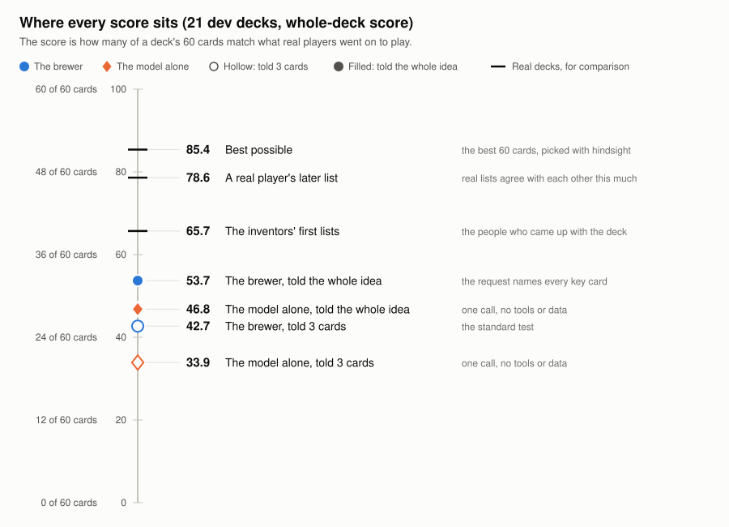
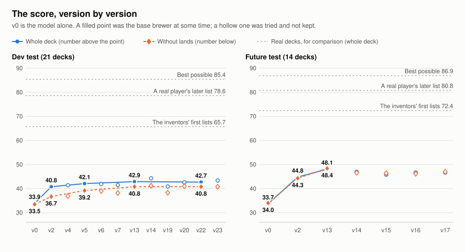
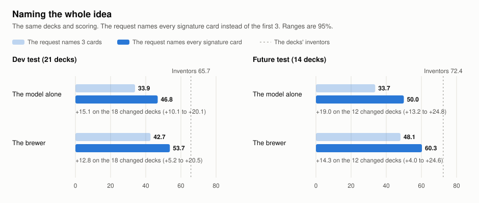
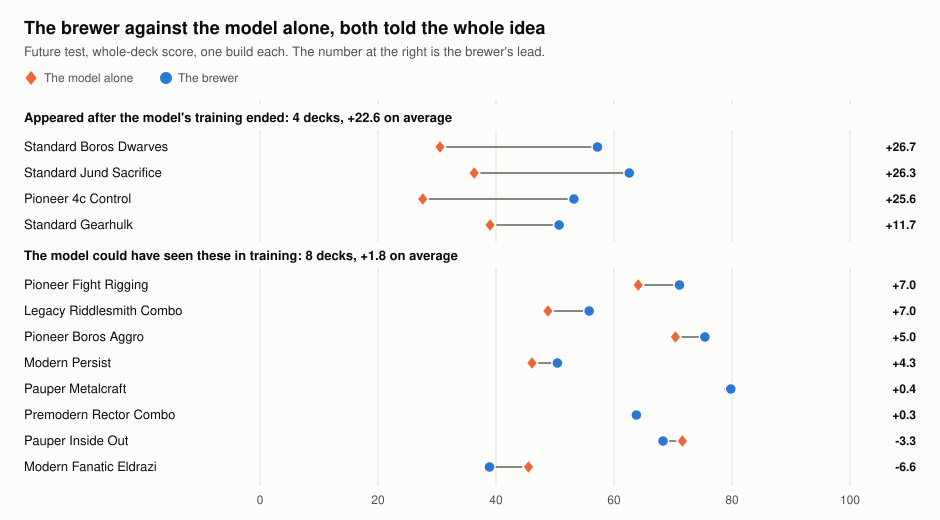

# decklists.ai

[](https://github.com/131ackknight/decklists-ai/actions/workflows/verify.yml)

An AI that brews Magic: The Gathering decks, and a record of measuring whether it is any good.

The brewer is a harness around Claude. The model proposes a deck; tournament data and plain code check it. Most of this repository is the measuring: frozen tests, a rule written down before each run, and every result kept, including the ones that failed.

**Status:** research code, published for reading. It is not a product. See [Rights](#rights).

## The question

Can an AI build a good deck that doesn't exist yet?

The test takes real decks that appeared from nothing, turns the clock back to the day before each one appeared, and asks the brewer to build it from a one-sentence request.

1. **Pick a real deck that appeared out of nowhere,** found in the history of public Magic Online results.
2. **Turn the clock back.** The brewer gets only the cards and decklists that existed before that day, so it can't copy the answer.
3. **Ask for the deck** in one sentence that names some of its key cards.
4. **It builds 60 cards.**
5. **Compare** with the lists real players settled on afterwards. The score is the matching cards out of 60, as a percent, averaged over those lists.



Nobody scores 100. Real players' own lists match each other at 79, and the best 60 cards anyone could pick score 85.

## What we found

| | Finding | The numbers |
| --- | --- | --- |
| 1 | **The harness beats the model alone, most on decks the model has never seen.** | +8.8 points on the 21 dev decks, +14.3 on the 14 future-test decks, +23.7 on the 6 decks from after the model's training cutoff |
| 2 | **Since the thirteenth version, nothing we built has made it better.** | A mana tool, a staples tool, a synergy shortlist, a reviewer, a played game, borrowed-spell lists and a land swap were each measured and dropped |
| 3 | **The test had a ceiling nobody had looked for.** | 85 is the best possible score, 79 a real later list, 66 the deck's own inventors |
| 4 | **The test was mixing two jobs: guessing the idea, and building the deck.** | The request named 3 of a deck's 6 or 7 defining cards. Naming them all took the brewer from 42.7 to 53.7 on dev and from 48.1 to 60.3 on the future test |
| 5 | **Given the idea, the model alone builds an old deck as well as the harness does. The harness matters where the model can't know.** | The brewer's lead over the model alone, both given the idea: +22.6 on decks from after the model's training, +1.8 on the rest |
| 6 | **The eval found a product bug.** | A request naming more than 6 cards could never get a deck. No test had named that many |







Findings 4 to 6, and the post-cutoff number in finding 1, rest on one build per deck. The scoreboard says so wherever it applies.

Two tables in the scoreboard round differently (per deck, or not at all), which is why the brewer on dev reads 42.8 in one and 42.7 in another.

Each finding with its evidence, how sure it is and what is still unknown: [docs/FINDINGS.md](docs/FINDINGS.md). How the tests are built and when a result is allowed to count: [docs/METHODS.md](docs/METHODS.md).

## How the work was done

- **The tests are frozen.** Each has a fingerprint over its decks, requests and settings ([evals/tests.ts](evals/tests.ts)). A test never changes under its name; a change is a new version.
- **Two test sets.** Changes are tried on the dev decks. The future test is looked at rarely, and the decks nothing was tuned on are reported apart.
- **A rule before the measurement.** Since November, each entry in the [build log](BUILD_LOG.md) states what will be counted, what result would mean what, and a guess, before the run. The guesses are scored afterwards, and the misses stay in.
- **Gains come with a range.** Versions are compared deck by deck with a 95% range, and a change is kept only if it clearly beats the current brewer ([evals/protocol.ts](evals/protocol.ts)).
- **Every paid run records itself:** the commit that ran, the data it read, what it cost and where its results are ([evals/runs.jsonl](evals/runs.jsonl)). Runs from before the register existed were added from their result files. Total spend is about $561, itemized in the log.
- **The scoreboard is generated, never edited.** [PROGRESS.md](PROGRESS.md) is written by [scripts/scoreboard.ts](scripts/scoreboard.ts) from the result files. The figures on this page are drawn from the scoreboard by [scripts/figures.ts](scripts/figures.ts), so they show only numbers it prints.
- **A person judged too.** The owner rated decks blind in several rounds ([evals/answers/](evals/answers/)). Where the owner's judgment and the automatic score disagreed, the log says so.

## What is in the repository

| Path | What it is |
| --- | --- |
| [docs/FINDINGS.md](docs/FINDINGS.md) | What was found, with the evidence for each claim |
| [docs/METHODS.md](docs/METHODS.md) | How the tests work and when a result counts |
| [BUILD_LOG.md](BUILD_LOG.md) | The lab notebook, newest first. Start with "The story so far" near the top |
| [PROGRESS.md](PROGRESS.md) | The scoreboard: every test, every version, every judging round |
| [HANDOFF.md](HANDOFF.md) | Working notes for whoever picks the work up next |
| [PLAN.md](PLAN.md) | The original build plan |
| [src/harness/](src/harness/) | The brewer: prompts, tools, the versions, and the model with no harness (`oneshot.ts`) |
| [src/cards/](src/cards/), [src/checker/](src/checker/), [src/sim/](src/sim/) | Card search, the deck checker and mana model, the goldfish simulator |
| [evals/](evals/) | The tests, the scoring, the protocol, the run register |
| [evals/results/](evals/results/) | Every saved build from every run |
| [evals/answers/](evals/answers/) | The owner's judging answers, exported |
| [scripts/](scripts/) | The runner, the scoreboard, and one script for each question the log asks. [scripts/README.md](scripts/README.md) lists them |

## What you can and can't rerun

**You can:**

```bash
pnpm install
pnpm verify        # typecheck, then the tests that need no downloaded data
pnpm figures       # redraws docs/figures/ from the scoreboard
pnpm cards:build   # downloads Scryfall's card files and builds the card index
pnpm verify        # now every test runs
```

On a fresh clone the typecheck passes and 157 tests pass; 25 more need the card index and are skipped until it is built. With it, all 182 run. CI does the first two steps on every push.

**You can't, from this repository alone:**

- **Recompute the scores.** The scoring reads tournament decklists exported from [Decklist Data](https://decklistdata.com), and those exports are not in the repository. The saved builds and the scoreboard computed from them are.
- **Brew for a past date.** That needs the same exports, cut to the date.
- **Run a paid test** without your own Anthropic API key. A build costs about $0.45.

## How it was built

It was built with Claude Code, and every commit is co-authored by the model. The owner set the questions, judged the decks, chose which tests and rules to adopt, and made every keep, drop and spending decision. Claude proposed designs, wrote the code and ran the analyses. The log keeps the mistakes on both sides, including the times the owner overruled the model.

The brewer runs on Claude Opus 5.5. Some comparisons use Haiku 5.5, Sonnet 5.5 and Fable 5.1.

## Limits

- **The test sets are small:** 21 dev decks and 14 future-test decks.
- **The score measures likeness to what players played.** It does not measure win rate.
- **The model may have read about most of the dev decks.** 19 of the 21 appeared before its training ended, so the future test and the post-cutoff decks are the fairer ones.
- **One model family.** Nothing here says how another model would do.

## Rights

No license. © 2026 131ackknight. All rights reserved. You are welcome to read the code and the results; reuse needs permission.

Magic: The Gathering and its card names belong to Wizards of the Coast. This project is unofficial and is not affiliated with or endorsed by Wizards. Card data comes from [Scryfall](https://scryfall.com). Tournament results come from Decklist Data.
