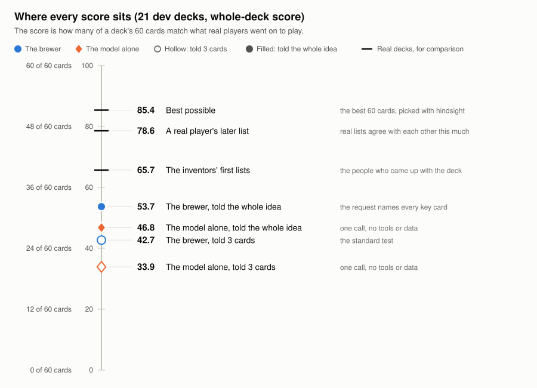
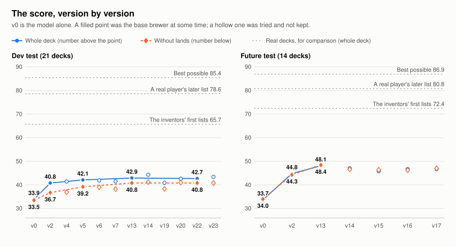
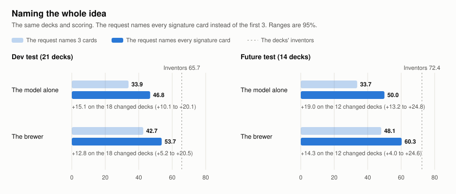
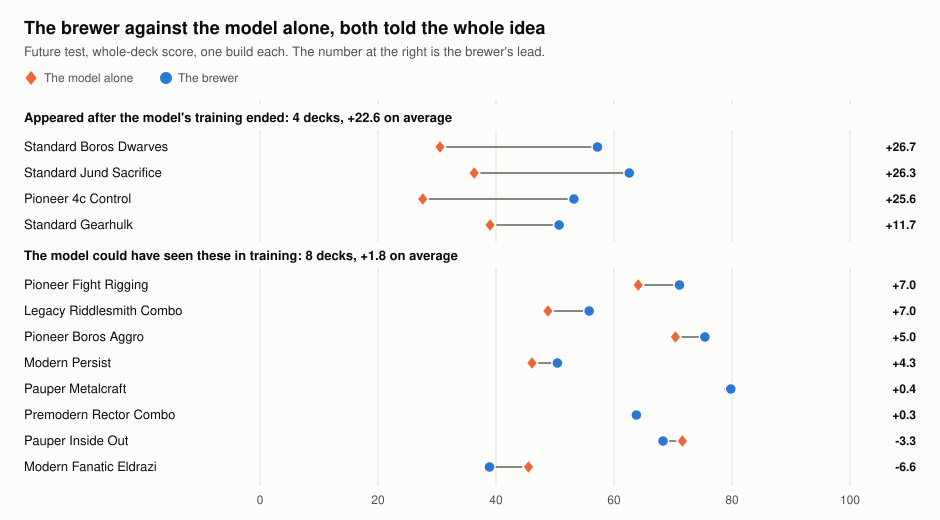

# Findings

What the project found, with the number behind each claim, how sure it is, and where it came from. The [methods](METHODS.md) page says how a result is allowed to count. The [scoreboard](../PROGRESS.md) has every number, and the [build log](../BUILD_LOG.md) has how each was reached.

Scores are out of 100. Gains are in points, compared deck by deck, with a 95% range in brackets. A range that includes zero means the gain can't be told from chance.

## 1. The score has a ceiling, and it is 85

- No list can score 100. A real player's settled list scores 78.6 against the other settled lists, and the best 60 cards anyone could pick with hindsight score 85.4.
- The deck's own inventors, in its first week, score 65.7.
- So the distance worth talking about is from the brewer to the inventors, not to 100.

*How sure:* these are counts over the real lists, not model runs. *Where:* [scripts/ceiling-check.ts](../scripts/ceiling-check.ts); the log entry of 2026-11-11, "What we were missing".

## 2. The harness beats the model alone, and by more on newer decks

The model alone is one call to the same model with no tools, data or checks. With the standard request, which names 3 of the deck's cards:

| Test | The model alone | The brewer | Gain |
| --- | --- | --- | --- |
| Dev, 21 decks | 34.1 | 42.8 | +8.8 (+4.6 to +13.0) |
| Future test, 14 decks | 33.8 | 48.1 | +14.3 (+6.0 to +22.6) |
| After the model's training cutoff, 6 decks | 26.3 | 50.0 | +23.7 (+7.3 to +40.0) |

- The model matters too. On the first harness, Haiku 5.5 scored about 33, Sonnet 5.5 37.6 and Opus 5.5 about 41.
- A bigger model was not always better. Fable 5.1 placed third of five in the owner's blind ratings of the original builder, and came in slightly below Opus on a one-call test at about three times the cost.

*How sure:* the dev row is 3 runs a side. The post-cutoff row is 1 run on 6 decks, and its range is wide. *Where:* scoreboard sections 2 and 2a.

## 3. The first harness was the big step. Nothing since the thirteenth version has helped

- **v2,** the first harness with card search, real decklists and a deck checker, was worth about 7 points on dev. Much of that was lands: without them the step is +3.3 (-0.3 to +6.8).
- **v5 to v13** added knowledge about the requested cards: how real decks play them, whether the deck has a line that wins, whether its enablers are there in number. On the whole deck this barely shows. Without lands, v13 is +4.1 (+0.5 to +7.6) over v2 on dev and +4.1 (-0.2 to +8.4) on the future test.
- **Everything since** was measured and dropped:

| Version | What it added | Gain in Added over the base at the time |
| --- | --- | --- |
| v14 | A mana base tool | +1.0 (-1.1 to +3.2) |
| v15 | A format staples tool | -2.3 (-6.5 to +2.0), future test |
| v16 | A shortlist of 150 synergy cards | +0.1 (-2.8 to +2.9), future test |
| v17 | A reviewer with evidence for each card, one revision | -2.8 (-7.8 to +2.3), future test |
| v19 | Plays one dealt game, then fixes the top three problems | -0.4 (-2.9 to +2.1), stopped after one run by a rule set before it |
| v20 | Lists little-played spells that real decks run beside the requested cards | +0.1 (-2.3 to +2.5) |
| v23 | Swaps extra basic lands for the format's usual fixing lands, in code | +0.6 (-0.0 to +1.1) on dev; lost lands on the decks it wasn't picked on |

The pattern across versions: everything that helped was knowledge about *these* cards or *this* plan. Everything generic (stages, a coach, staples, shortlists) did nothing or hurt.

*How sure:* the v2-to-v13 comparison without lands was made after seeing the scores, so it is a strong lead, not a planned test. *Where:* scoreboard sections 2b and 2h; [scripts/no-lands-check.ts](../scripts/no-lands-check.ts).

## 4. Matching a deck is partly copying one

A build that copies an old deck scores what that deck scores. "Added" is the score minus the score of the single closest earlier list.

| | Score | Share of the build found in one earlier list | Added |
| --- | --- | --- | --- |
| The inventors | 65.7 | 49% | +28.9 |
| The brewer (v13) | 43.4 | 58% | +10.7 |
| The model alone | 34.1 | 46% | +7.1 |

The inventors add almost three times what the brewer adds. Since November the keep-or-drop rule uses Added, with the plain score as a guard.

*Where:* scoreboard section 2f; `addedScore` in [evals/score.ts](../evals/score.ts).

## 5. Lands are a third of the score, and three fixes failed

- Nonbasic lands are 28 points of a real deck and about 8 of the 23 points between the brewer and the inventors on dev.
- A mana base tool (v14), a land note the model acts on, and a land swap in code (v23) each looked plausible. The swap shared 0.4 more lands on the dev decks and 0.7 fewer on the six future-test decks it wasn't picked on.
- Different isn't always worse: played out in the simulator, the brewer's mana casts its spells as often as the real decks' mana does.
- The land losses sit in the decks where the brewer built a different deck from the inventor. Lands follow the deck.

*Where:* the log entries of 2026-11-10 on lands; [scripts/land-swap-check.ts](../scripts/land-swap-check.ts), [scripts/mana-play-check.ts](../scripts/mana-play-check.ts).

## 6. The test was mixing two jobs

The standard request names 3 signature cards. By the test's own rule the decks have 6.6. The unnamed ones are worth more points than the named ones, and the brewer can't find most of them: 44% of those copies are nowhere in the data it can see, and 30% it is shown and passes over.

Naming them all, with the same decks and scoring:

| | Dev: 3 cards | Dev: every card | Future test: 3 cards | Future test: every card |
| --- | --- | --- | --- | --- |
| The model alone | 33.9 | 46.8 | 33.7 | 50.0 |
| The brewer | 42.7 | 53.7 | 48.1 | 60.3 |
| The inventors | 65.7 | 65.7 | 72.4 | 72.4 |

- On the decks whose request changed, the brewer gains +12.8 (+5.2 to +20.5) on dev and +14.3 (+4.0 to +24.6) on the future test.
- The gain is the named cards themselves. Lands (+2.4, -2.0 to +6.7 on dev) and the other spells (-3.3, -5.9 to -0.7) do not improve.
- The model alone with the whole idea beats the brewer without it.
- This is a fuller question, not a smarter brewer. It is also how a real user would ask.

*How sure:* one build per deck. The rule for calling it a jump (+5 or more, range clear of zero) was written before the runs. *Where:* scoreboard section 2i; [evals/idea-tests.ts](../evals/idea-tests.ts); the log entries of 2026-11-11.

## 7. Given the idea, the harness matters where the model can't know

Both given every signature card, on the future test:

| Decks | The model alone | The brewer | The brewer ahead by |
| --- | --- | --- | --- |
| 4 that appeared after the model's training ended | 33.4 | 55.9 | +22.6 (+11.0 to +34.1) |
| The other 8 | 61.2 | 62.9 | +1.8 (-2.4 to +5.9) |

- On a deck the model could have read about, it builds as well alone.
- On a newer deck the brewer is far ahead, and most of that is lands: 23.0 points from lands against 4.5. The model alone doesn't know which lands and cards a format has after its training.
- 19 of the 21 dev decks are older than the model's training, which is why the brewer's lead there looked small (+6.2).

*How sure:* the split into those 4 and 8 was fixed in the log before the future-test run. It is still 4 decks, with one build each. *Where:* scoreboard section 2i.

## 8. The automatic score and a person disagreed, and it is not settled

The owner judged decks blind: 17 fixed prompts, every version's decks shuffled together, yes or no to "would you play it".

| Version | Yes, of 17 |
| --- | --- |
| v2 | 9 |
| v18 | 11 |
| v13 | 10 |
| v19 (v13 plus one played game) | 13 |

On the automatic score v19 was no better than the base (-0.4, -2.9 to +2.1, after one run), and a rule set beforehand stopped it there. The person preferred it. The two measure different things, likeness to real decks and whether a deck is playable, and the project has not reconciled them.

*Where:* scoreboard sections 3 and 4; [evals/answers/](../evals/answers/).

## 9. What the process caught

Mistakes found by the checks, by the owner or by a later analysis. All are in the log where they happened.

| When | What was wrong | How it showed |
| --- | --- | --- |
| Nov 7 | Runs weren't tied to code, data or cost, and hand-typed numbers had drifted | The owner asked whether we were being careful with the data. The frozen tests, the run register and the generated scoreboard followed |
| Nov 8 | The score rewarded copying an old deck | A look at how much of each build came from one earlier list. Added replaced it in the rule |
| Nov 9 | Standard cards scored before they were legal | A legality check on the deck's date. Fixed as new test versions, not an edit |
| Nov 10 | The inventors' row counted decks with more lists more heavily | Reconciling two tables. 72.2 became 65.7 |
| Nov 10 | A land fix that worked on dev | A free check on decks it wasn't picked on, before any paid run |
| Nov 11 | A request naming more than 6 cards could never get a deck | 5 of the first 11 builds of a new test came back empty. The run was stopped; $4.54 was lost |

## What is not known

- **Whether the idea-named gain holds with repeat runs.** Each deck has one build.
- **How large the brewer's lead on new decks really is.** It rests on 4 to 6 decks.
- **Whether likeness to real decks tracks strength.** Nothing here measures win rate.
- **Whether a deck the owner would play scores higher.** The one direct comparison (finding 8) says not necessarily.
- **How any of this carries to another model family.**
